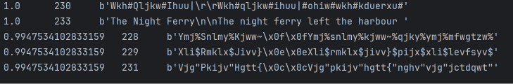

# Zad 1
Szyfr Cezara jest cykliczny, więc niezależnie od klucza histogram ma tą samą strukturę. Stopień przemieszania będzie taki sam dla każdego klucza

Najlepsi kandydaci:  
kolumny kolejno - udział dozwolonych znaków, klucz, początek tekstu

Można zauważyć poprawny tekst i ręcznie wybrać klucz 233 (pozycja druga).  
# Zad 2
Dane przed zaszyfrowaniem zgadzają się z danymi po zaszyfrowaniu.

Kryptogramy pokazane szesnastkowo:

dla klucza "SZYFR"
['95ac9a9393', '95ac9a9393', '95ac9a9393']

dla klucza "KOD"
['8da1859890', '869d90918c', '91968c9c85']

W przypadku klucza "SZYFR" powtarzające się słowo "BRAMA" ma dokładnie tę samą długość co klucz (5), przez co klucz pokrywa się z tekstem i generuje identyczne fragmenty w kryptogramie. Natomiast przy kluczu "KOD" długości się nie zgadzają, więc powtarzające się słowa są szyfrowane za każdym razem innymi przesunięciami.

# Zad 3
Dwukrotne szyfrowanie ponownie odtwarza wejście.  
Najlepsi kandydaci:

1. Klucz: tat | Entropia: 4.3910
2. Klucz: neg | Entropia: 7.4304
3. Klucz: mcn | Entropia: 7.4512
4. Klucz: oxo | Entropia: 7.4536
5. Klucz: tnx | Entropia: 7.4592

Tekst odszyfrowany za pomocą klucza "tat" wygląda jak naturalny angielski.  
\
Liczba prób: 17576  
Czas przeszukiwania: 3.514 s  
Entropia całego kryptogramu: 7.9271  
Entropia całego odszyfrowania: 4.3259  

Entropia kryptogramu jest bardzo dobra, ponieważ jest bliska 8, co oznacza, że kryptogram wygląda jak losowy szum. Natomiast entropia po odszyfrowaniu jest znacznie niższa, ponieważ prawidłowy tekst w naturalnym języku zawiera dużo powtarzających się liter i ma mniejszą losowość niż szyfr.

Ponowne szyfrowanie odtwarza kryptogram nawet z błędnym kluczem, bo matematyka XOR działa w dwie strony - dwukrotne nałożenie tego samego strumienia kasuje jego działanie i oddaje pierwotny kryptogram. Nasz ranking entropii zawiódłby wtedy, gdyby plik nie był zwykłym tekstem w naturalnym języku, tylko np. losowymi znakami czy plikiem nietekstowym.
